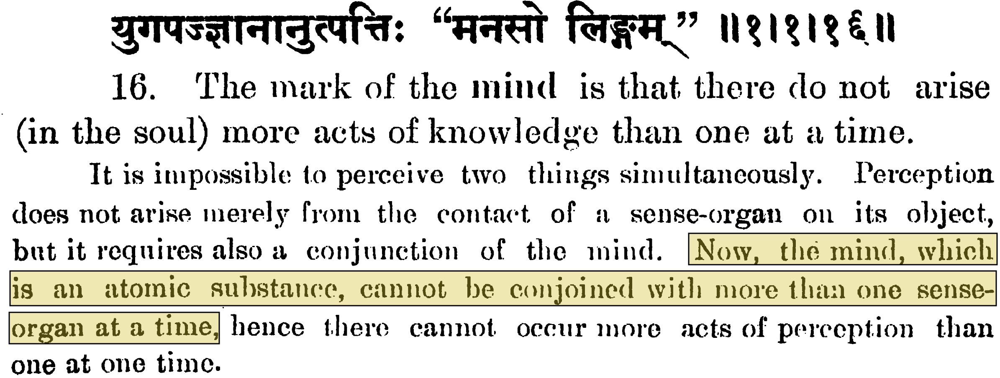

---js
const title = "On the Atomicity of Mind in the Nyaya Sutra";
const date = "2026-11-19T17:00:00-05:00";
const tags = ["philosophy", "NyayaSutra"];
const draft = false;
---

In this post, we discuss our understanding of the two properties of the mind
and hypothesize what's meant by the *atomicity* of the mind in texts like the
Nyaya Sutra.

In a commentary on the Nyaya Sutra [1][2], the mind is characterized as an atomic
substance:

Now, we give an intuitive understanding of what's meant by atomicity. It means
that:

1. The mind can process inputs from only one sense at a time.
2. The mind is always processing input from one sense, even in deep sleep (N3
   stage sleep, or slow-wave sleep [3]).

By senses, we mean the five senses, touch, hearing, etc., but we define these
senses similarly to how we defined sound [4], i.e., all sensory input that comes
to the mind through the concept of ears is sound, making pressure waves just
one manifestation of sound.

We support our #1 claim with the common argument that context switching has a
cognitive load [5][6], although these studies don't examine switching at the
sensory level, i.e., by isolating the senses, and are at the task-level. We
argue that if the mind could simultaneously process inputs from two senses, A
and B, at a time, then there wouldn't be any load due to context switching.
More verbosely, say the mind is processing only sense A and switches to only sense B. If
the mind can process inputs simultaneously, then the switch shouldn't involve
any cognitive load at all; thus, the switch should be seamless, which is
approximately not the case.

We support our #2 claim with research like [7], which note that the mind
processes sound even in deep sleep, although the amplification of
understandable stimulus is dampened [8]. Assuming that deep sleep is the state of
mind in which it does the least sensory processing, even then the mind is
processing one sense. So, this supports #2.

We note that books like *Brave New World* [9] also use a trope based on #2 for
brain-washing. Furthermore, we note that we have previously argued that
*Shruti* [10][11] is heard in a meditative state that is like deep sleep through the
concept of sound (*shabdah*), because the mind is processing sound even in the
meditative state which is like slow-wave sleep.

Thus, we give our understanding of what's meant by the atomicity of the mind
in texts like the Nyaya Sutra, and we provide some simple and
straightforward arguments based on easily accessible scientific research.

  
[1] https://archive.org/details/nyayasutrasofgautamasatishchandravidyabhushannyayadarsanaofgautamaraghunathgosh_202003_872_G

[2] https://en.wikipedia.org/wiki/Ny%C4%81ya_S%C5%ABtras

[3] https://www.ncbi.nlm.nih.gov/books/NBK526132/

[4] https://m-chaturvedi.github.io/blog/056/

[5] https://pmc.ncbi.nlm.nih.gov/articles/PMC7075496/

[6] https://www.cell.com/trends/cognitive-sciences/abstract/S1364-6613(03)00028-7?large_figure=true&mobileUi=0

[7] https://www.jneurosci.org/content/45/32/e0368252025

[8] https://www.nature.com/articles/s41562-018-0502-5

[9] https://en.wikipedia.org/wiki/Brave_New_World

[10] https://en.wikipedia.org/wiki/%C5%9Aruti#Distinction_between_%C5%9Bruti_and_sm%E1%B9%9Bti

[11] https://m-chaturvedi.github.io/blog/055/
